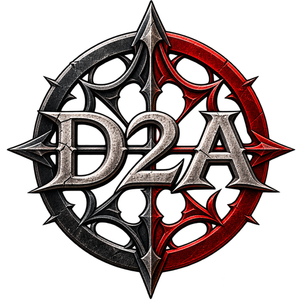

<p align="center"></p>

# D2 Assistant

**A safer, searchable item bank for offline Diablo II: Lord of Destruction.**

D2 Assistant helps organize classic Diablo II items and move selected gear back onto local character saves. It is a native desktop app built with Tauri; item data stays on your computer.

> **Compatibility:** Character and stash editing currently targets original Diablo II + Lord of Destruction save files. Diablo II: Resurrected and online/Battle.net characters are not supported. D2R and Reign of the Warlock recipes are optional reference data only; turn them on from **Features** if you want to browse them.

## What it does

- **Local item bank:** import a supported version 96 `.d2x` stash, browse item cards, and search/filter by item type, rarity, requirements, sockets, and transfer status.
- **Bulk selection:** refine results with multiple filters, select visible items, and keep selections while changing filters.
- **Safer transfers:** prepare selected items for a chosen character's inventory or personal stash. The app writes `_d2a` save copies, keeps original character files untouched, backs up existing app copies, and validates the generated file.
- **Character overview:** read local character saves and compare known item class/level requirements with a transfer target.
- **Runeword reference:** browse ordered runes, sockets, bases, and bonuses offline. Standard LoD recipes are shown by default; optional D2R/Reign references are clearly marked and can be hidden.

## Why I built this

> I’ve been running Diablo II on Mac hardware through Wine for years. I tried ATMA, D2 Character Editor, GoMule, and browser tabs, but the workflows were frustrating and I kept needing separate tools for offline character and item management. I wanted one place to organize characters, transfer items in bulk, search and filter well, plan builds, and look up runeword recipes. I asked my agent, **helloam.bot**, to help build it. A few hours later, I had something much better for my workflow. Now I use D2 Assistant as a companion while I play offline and plan characters. The project is still growing toward that all-in-one goal; character skill, attribute, and gold editing are planned for the next version.

## Safety and known limits

- Work on backups. Before importing a supported `.d2x`, the app creates and verifies a backup, moves the item records into its local bank, then empties the selected stash. Review the source path before confirming this operation.
- Character exports create `_d2a` copies and never overwrite the original save. Check the output and open it in the game before relying on it.
- The current stash transfer path supports version 96 `.d2x` files. Other stash formats are rejected.
- Item requirements added by some magical, set, unique, crafted, or runeword properties may be unknown. The app labels unknown requirements rather than guessing.
- The bank uses item fingerprints to avoid accidental repeat exports inside the app. Offline saves have no authoritative server, so the app cannot prove ownership or prevent someone restoring an older backup.
- This is an early release. Keep independent backups and report any save compatibility issue before doing bulk transfers.

## Download

Download the package for your operating system from [GitHub Releases](https://github.com/augmentedmike/d2-assistant/releases):

- **macOS:** open the `.dmg`, then move D2 Assistant to Applications. The initial build is unsigned and may require Control-click → Open on first launch.
- **Windows:** run the `.msi` installer or the `.exe` installer when provided. Windows may show a SmartScreen warning because the release is not code-signed.
- **Linux:** use the `.AppImage` or `.deb` package. Package support depends on the distribution's WebKitGTK runtime.

If an installer is missing for your platform, that platform's release build has not completed yet. Download only from this repository's Releases page.

## First run

1. Launch D2 Assistant.
2. On **Characters**, choose your Diablo II save folder with **Browse…**. The selection is saved locally on this computer.
3. Open **Bank** and choose a `.d2x` file only when you intend to back it up, move all its items into the bank, and empty that stash file.
4. Search and filter the bank, then select items and choose a character and destination.
5. Check the generated `_d2a` save in game. Keep your original save and the verified stash backup.

## Contributions

Contributions from people and coding agents are welcome. **We especially need contributors who play the current D2R release** to help implement and validate its save formats, item tables, and version changes. We also welcome research and contributions for a local item fingerprint/duplicate-analysis utility that could help Battle.net players identify exact matches or suspiciously similar items from data they provide.

The current release does not read online characters, connect to Battle.net, or guarantee server-side dupe protection. Fingerprints can report evidence and confidence; they cannot prove an online item's ownership or authenticity. Do not submit account credentials or private save files. See [CONTRIBUTING.md](CONTRIBUTING.md) for the quality bar, feature voting, and pull-request process. Vote on ideas in [GitHub Discussions](https://github.com/augmentedmike/d2-assistant/discussions). Optional features will use local feature flags so users can opt in or out; safety behavior will never be hidden behind a flag.

## Building from source

Prerequisites: Bun, Rust, and the native Tauri dependencies for your operating system. See the [Tauri prerequisites](https://v2.tauri.app/start/prerequisites/).

```sh
bun install --frozen-lockfile
bun run build
bun run tauri:dev
```

Build the local native app with:

```sh
bun run tauri:build
```

This project currently builds for macOS on the development machine. Windows and Linux installers are built by the release workflow on native GitHub-hosted runners.

## Roadmap

- **Next version:** add class skill trees and an opt-in character editor for skill allocation/reset, attribute allocation/reset, and character gold.
- Invite D2R contributors to bring current-version save-format knowledge and sanitized fixtures; explore local fingerprint analysis for duplicate screening without connecting to Battle.net.
- Improve item-property and requirement decoding.
- Add a more complete backup and restore workflow.
- Add optional, user-controlled experimental features.
- Investigate Android as a future target after the desktop save workflow is stable. Android is not supported in this release.
- A peer-to-peer marketplace for offline LoD items is deferred; it is not part of this release.

See [CHANGELOG.md](CHANGELOG.md), [TODO.md](TODO.md), and the [deferred marketplace concept](MARKETPLACE-PRD.md).

## License

D2 Assistant is released under the MIT License. The bundled runeword dataset includes its own attribution and license in [`src-ts/data`](src-ts/data).
